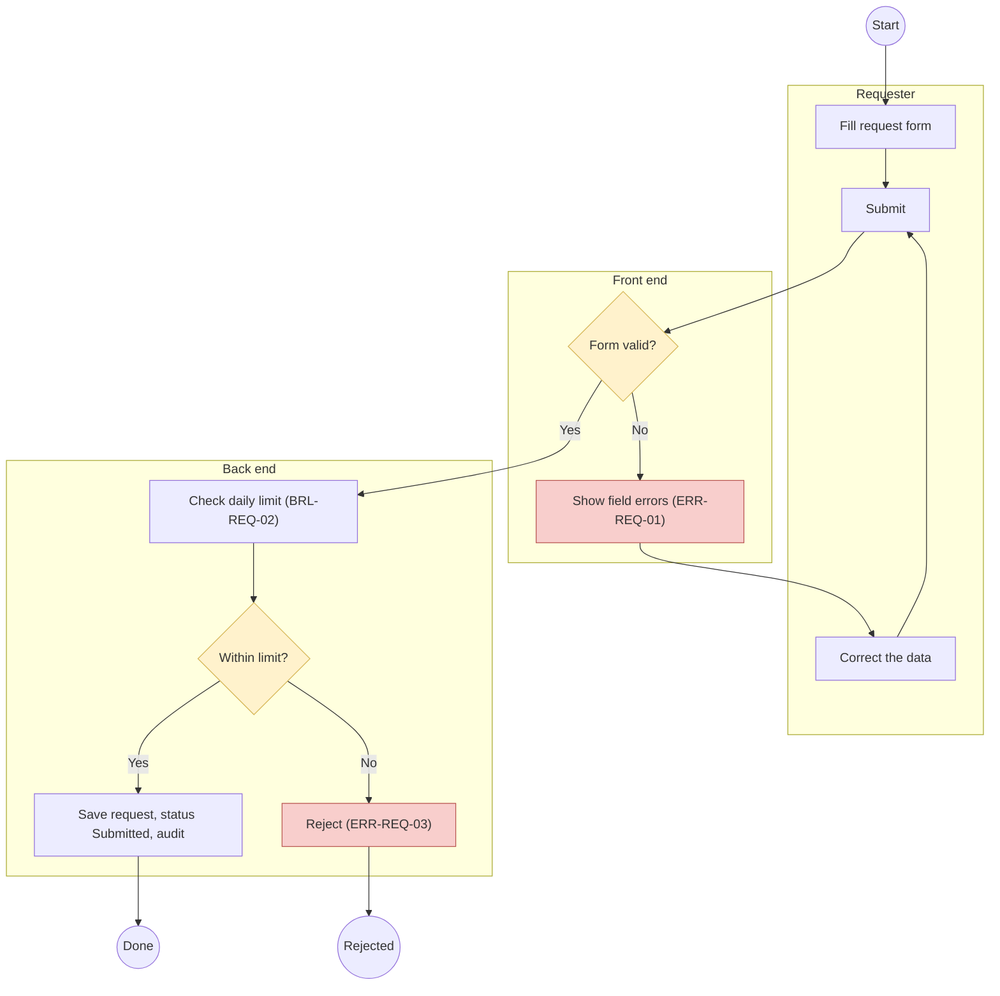
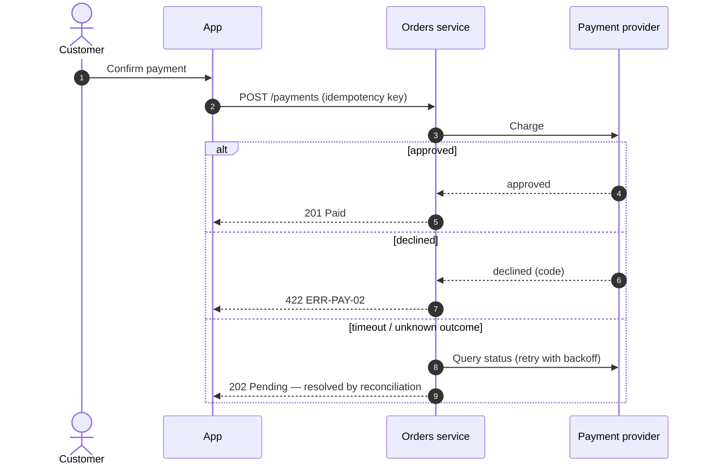
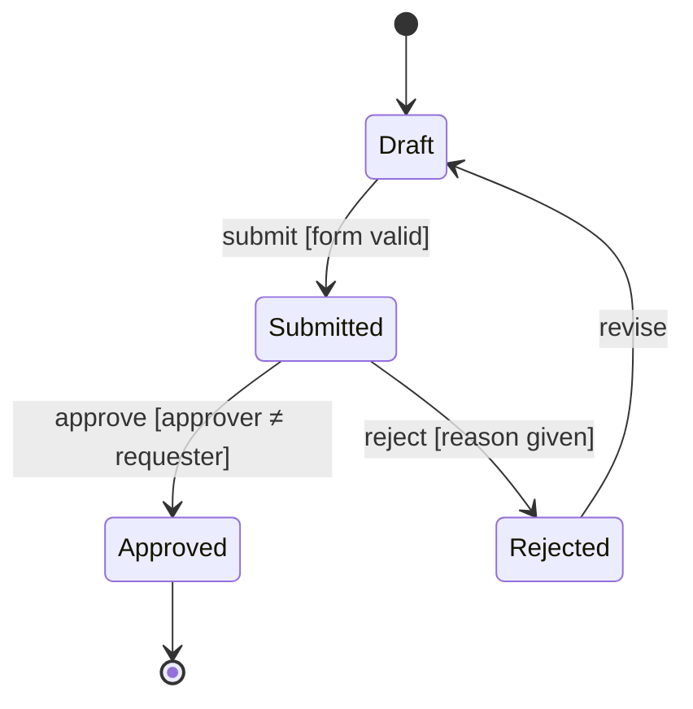

# Process flows and diagrams

A diagram is a specification in picture form: reviewers find missing branches in a picture that they would miss in prose. Draw only what the sources say; a branch you cannot label is a question, not a guess.

## When to use

- A use case, approval chain or business process needs a swimlane diagram.
- System-to-system interactions need a sequence diagram (including failures).
- An entity has a lifecycle (draft → submitted → approved…) that needs a state diagram.
- As-is vs to-be comparison for discovery.

## When not to use

- Behaviour is not yet specified → `sdlc-ba-functional-spec` (or `sdlc-ba-requirements`) first.
- Technical architecture diagrams (containers, deployment) → `sdlc-sa-solution-design`.

## BA conventions (shared by every sdlc-ba-* skill)

- **Label, don't upgrade:** facts, decisions, requirements, assumptions, constraints, hypotheses, risks, dependencies, out-of-scope items, conflicts and open questions stay distinct.
- **Stable IDs:** reuse the IDs of the source (`UC-`, `FL-`, `BRL-`, `ERR-`, `SCR-`, `API-`, `Q-`); never invent new requirement IDs in a diagram.
- **Source of truth:** recorded decision → baselined requirements → functional spec → process flow → UI spec → SRS. A diagram that reveals a new rule or branch raises `Q-`/`CR-` upstream instead of drawing it as fact.
- **Draft vs baseline:** DRAFT until approved; revisions are new versions, never silent edits of an approved diagram.
- **Unattended runs:** no human available → draw what is supported, mark unknown branches with a `Q-` note, list "Needs approval: … — <approver>"; cannot proceed → first line `BLOCKED: <reason>`.

## Choose the diagram

| Question it answers | Diagram | Mermaid |
|---|---|---|
| Who does what, in which order, with which decisions? | Swimlane flowchart | `flowchart TB` with one `subgraph` per lane |
| Which system calls which, with what, and what if it fails? | Sequence diagram | `sequenceDiagram` with `alt`/`opt`/`loop` |
| Which states can an entity be in and how does it move? | State diagram | `stateDiagram-v2` |
| How does the end-to-end business process cross departments? | Swimlane flowchart at business level (one lane per department) | `flowchart LR` |

If the organisation mandates BPMN or a drawing tool, keep Mermaid as the reviewable source and state the mapping (start/end events, tasks, exclusive gateways, message flows); export only when asked.

## Procedure

1. **Read the sources:** use case or functional spec (flows, rules, validations, messages), UI spec if any, integration notes.
2. **Identify lanes** (real actors and systems: user role, front end, back end/service, external system, scheduler, notification service), the trigger, the main path, alternative paths and error paths.
3. **Clarify before drawing** (at most 5–7 questions, grouped): trigger type (user action, schedule, inbound call); every decision condition; what happens when validation fails (retry? abort?); approvals and confirmations; what is stored, audited and notified; timeouts and unknown outcomes with external systems; extra lanes needed.
4. **Confirm understanding** in a short summary (lanes, main path, exceptions, special points). Unattended: proceed and mark assumptions.
5. **Draw** following the conventions below; keep step IDs aligned with the functional spec (`FL-…` / use-case step numbers).
6. **Add the step table** so the diagram is reviewable in text and traceable.
7. **Self-check** with the checklist; present as DRAFT; revise as new versions.

## Conventions

- Exactly one start; every path reaches an end (`Done`, `Cancelled`, `Rejected`…) — no dangling nodes.
- Node text: verb + object ("Validate amount", "Create transfer"). Decisions are questions ("Amount ≤ daily limit?") with **every** outgoing edge labelled; the labels cover all outcomes.
- Every error node leads to a retry/correction step or to a terminal outcome — never nowhere.
- Show where data is persisted, audited and where notifications are sent.
- External calls show the failure branch (error, timeout, unknown outcome → status check or reconciliation).
- Keep one diagram ≤ about 25 nodes; split by phase or sub-flow and link them by name.
- Style classes: `decision`, `error`, `external`, `done` — consistent across diagrams. No colours carry meaning without a legend.
- Mermaid hygiene: quote labels containing punctuation (`A["Check: limit?"]`); do not use the bare word `end` as a node id; keep ids short and unique (`U1`, `FE2`, `BE3`).

## Skeletons







## Step table

```markdown
| Step | Lane | Action / decision | Rule / message refs | Next (condition → step) | Source |
|------|------|-------------------|---------------------|-------------------------|--------|
| 1 | Requester | Submit form | — | → 2 | UC-REQ-01 step 1 |
| 2 | Front end | Form valid? | ERR-REQ-01 | Yes → 3 · No → 2a | FL-REQ-01-02 |
```

## Checklist

- [ ] One start; every path ends in a named outcome.
- [ ] Every decision has labelled branches covering all outcomes.
- [ ] Every error path goes to retry/correction or a terminal outcome.
- [ ] Lanes are real actors/systems with owners; no "misc" lane.
- [ ] External calls show failure and timeout handling.
- [ ] Persistence, audit and notifications are visible where they happen.
- [ ] Step table matches the diagram and cites sources; unknowns are `Q-` notes.
- [ ] Mermaid renders (balanced subgraphs, quoted labels, unique ids).

## Stop conditions

- A decision condition or error behaviour is undefined in the sources — ask; do not invent a branch.
- The flow needs a lane or step that adds scope — raise `Q-`/`CR-` upstream.

## Hand-off

Approved flows go to `sdlc-ba-ui-spec` (screens follow the front-end lane and user actions), `sdlc-ba-srs` (business process section), `sdlc-sa-solution-design` and `sdlc-sa-integration` (sequence diagrams as the starting point), and testers (each path is a test scenario).
