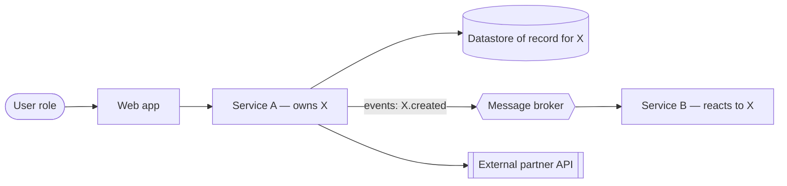

# Solution document template

Used by `sdlc-sa-solution-design`. Keep all headings; write `N/A because …` for sections that do not apply. Mark proposals that are not verified against real environments as "(proposed)".

````markdown
# Solution — <initiative / epic> · v<N> · DRAFT | IN REVIEW | APPROVED
Architect: … · Date: YYYY-MM-DD · Sources: <functional spec vN, SRS vN, code paths, docs>

## Intake
Problem · drivers · scope IDs (UC/BR) · decision makers · constraints · decision this document enables

## Discovery
| # | Item | Findings | Sources |
|---|------|----------|---------|
| 1 | Current system context | | |
| 2 | Relevant components | | `path/…` |
| 3 | Patterns, standards, ADRs | | |
| 4 | Data landscape | | migrations `…` |
| 5 | Integration landscape | | |
| 6 | NFR sources | | |
| 7 | Operations | | |
| 8 | Risks and unknowns | | |

## Top NFR drivers
| ID | Quality attribute | Threshold | How measured | Trade-off forced |
|----|-------------------|-----------|--------------|------------------|

## Options
| Criterion | Option A | Option B | Option C |
|-----------|----------|----------|----------|
| Functional fit | | | |
| NFR fit | | | |
| Fit with landscape | | | |
| Build / run cost | | | |
| Time | | | |
| Risk | | | |
| Team skills | | | |
| Reversibility | | | |
Recommendation: <option> because …

## 1. Context and goals
## 2. Assumptions, constraints, out of scope
## 3. Architecture overview

## 4. Components and responsibilities
| Component | New / changed / unchanged | Responsibility | Owner | Interfaces |
## 5. Key flows
<one sequence diagram per main use case; include failure and timeout branches>
## 6. Data architecture
| Entity | System of record | Owner | Classification | Retention | Change (proposed) |
Consistency model · migration/backfill · archival
## 7. Integration
| INT | Counterpart | Style | Contract | Reliability (timeout/retry/idempotency) | Details in |
## 8. NFR realisation
| NFR | Tactic | Where | Verification (fitness function) |
## 9. Security and privacy
AuthN · AuthZ (role and object-level rules) · secrets (names only) · encryption · audit
| Threat | Asset / flow | Mitigation | Residual risk |
## 10. Deployment topology and environments
Runtime units · scaling · network zones and exposure · configuration and flags · environment matrix
## 11. Observability and operations
Logs · metrics · traces · alerts and SLOs · runbooks · backup and DR (RPO/RTO) · support model
## 12. Migration, rollout and rollback
Sequence · compatibility · cutover · flags · backfill · rollback/roll-forward · irreversible steps
## 13. Decisions, risks and trade-offs
| ADR | Decision | Status | Alternatives | Consequences |
| Risk | Likelihood / impact | Mitigation | Owner |
Accepted technical debt · cost outline

## Needs approval
- Needs approval: <decision> — <approver role>

## Open questions
| ID | Question | Owner | Impact if different | Assumption used meanwhile |
````

ADR format (one per significant decision):

```markdown
# ADR-<NNN>: <decision in one line>
Status: PROPOSED | ACCEPTED | SUPERSEDED by ADR-<x> · Date: YYYY-MM-DD · Deciders: …
## Context — forces, constraints, drivers (NFR IDs)
## Options — | Option | Pros | Cons | Cost | Reversibility |
## Decision — chosen option and why
## Consequences — trade-offs accepted, follow-up work, what to monitor, revisit trigger
```
